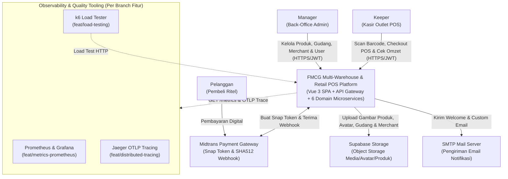
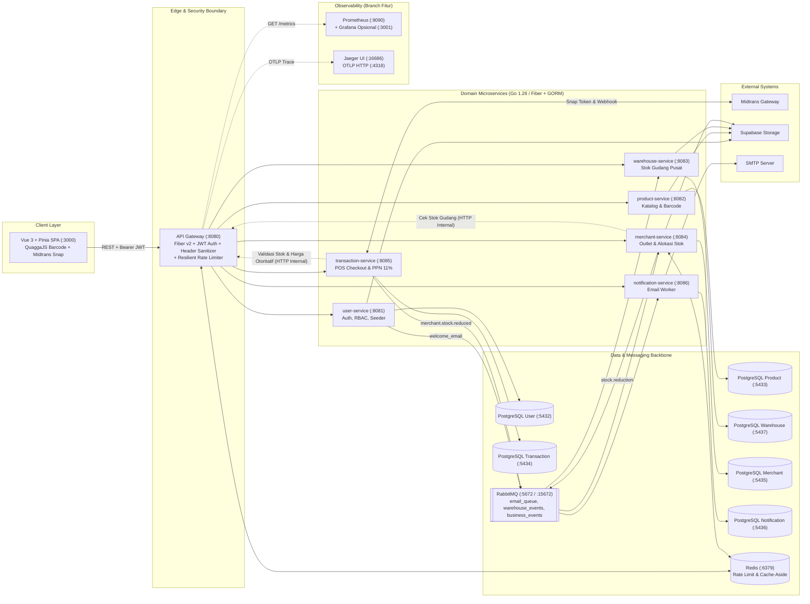

# FMCG Multi-Warehouse & Retail POS Platform

[](https://github.com/odealidj/Golang-Microservices-Vue-Warehouse-POS/actions/workflows/ci.yml)


Platform distribusi multi-gudang dan kasir (**Point of Sale**) untuk jaringan grosir & ritel FMCG / sembako kemasan. Dibangun menggunakan **7 microservices Go (Fiber v2 + GORM)** dengan pola **Database-per-Service (6 PostgreSQL)**, **Redis**, **RabbitMQ**, **Midtrans Snap**, **Supabase Storage**, dan **Vue.js 3 SPA**.

> **Dokumentasi Arsitektur Lengkap**: Lihat folder [`docs/`](docs/README.md) untuk diagram proses bisnis, sequence diagram teknis, ERD 6 database, panduan observability/testing, dan Postman Collection.

---

## Daftar Isi

- [Ringkasan Bisnis & Studi Kasus](#ringkasan-bisnis--studi-kasus)
- [Diagram Konteks & Arsitektur Sistem](#diagram-konteks--arsitektur-sistem)
- [Tech Stack](#tech-stack)
- [Katalog Microservices & Alur Event-Driven](#katalog-microservices--alur-event-driven)
- [Keunggulan Sistem](#keunggulan-sistem)
- [Branch Fitur](#branch-fitur)
- [Struktur Repository](#struktur-repository)
- [Cara Menjalankan Project](#cara-menjalankan-project)
- [Pengujian, Quality Gate & CI/CD](#pengujian-quality-gate--cicd)

---

## Ringkasan Bisnis & Studi Kasus

Aplikasi ini memodelkan alur *supply chain* ritel modern secara *end-to-end*, mulai dari pengelolaan stok di **Gudang Pusat/Regional (`Warehouse`)**, alokasi distribusi ke **Outlet/Toko Cabang (`Merchant`)**, hingga **Transaksi Kasir Pelanggan (`POS`)**:

| Aktor | Peran | Alur Utama |
|---|---|---|
| **Manager** | Back-Office | Mengelola master kategori & produk ber-barcode, manajemen gudang & stok pusat, alokasi stok dari gudang ke outlet merchant, serta manajemen user & RBAC (`Manager` / `Keeper`). |
| **Keeper** | Front-Office / Kasir | Memantau stok outlet yang dipegangnya, menjalankan checkout POS 3 langkah (data pelanggan → scan barcode kamera via **QuaggaJS** / pilih produk dengan validasi stok *real-time* → review subtotal + **PPN 11%** + pembayaran **Midtrans Snap**), serta memantau omzet outlet. |
| **Pelanggan** | Eksternal | Melakukan pembelian di outlet dan menyelesaikan pembayaran digital melalui halaman/popup **Midtrans Snap** (QRIS, Virtual Account, e-wallet). |

---

## Diagram Konteks & Arsitektur Sistem

### 1. System Context Diagram (C4 Level 1)

Menggambarkan batasan sistem secara keseluruhan, aktor pengguna, sistem eksternal, serta perangkat observability dan pengujian.



### 2. Overall Container & Microservices Architecture

Memetakan interaksi sinkron via **API Gateway**, komunikasi internal antar-service, isolasi **Database-per-Service**, *caching* **Redis**, *messaging* **RabbitMQ**, serta integrasi eksternal.



---

## Tech Stack

| Layer | Teknologi & Library Utama | Peran |
|---|---|---|
| **Frontend** | Vue `3.5`, Vite `5`, Pinia `2`, Vue Router `4`, Tailwind CSS `3`, QuaggaJS (`quagga`), Node.js `node --test` | SPA Back-Office & Kasir POS, *state management*, scanner barcode kamera, UI Midtrans Snap, unit test store |
| **Backend & Framework** | Go `1.26` (`api-gateway` `1.24`), Fiber `v2`, GORM + `pgx/v5`, `golang-jwt/jwt/v5`, `cobra`, `viper`, `validator/v10`, `zerolog`, `bcrypt`, `gomail.v2` | 7 microservice modular (Clean Architecture: `controller` → `usecase` → `repository` → `model`) |
| **Data & Messaging** | PostgreSQL x6 (Database-per-Service), Redis (`go-redis/v9`), RabbitMQ (`streadway/amqp`) | Isolasi database tiap domain, rate limiting terdistribusi, *cache-aside*, event-driven stock & email |
| **Integrasi Eksternal** | Midtrans Snap API & Webhook, Supabase Storage, SMTP Server | Pembayaran digital + verifikasi webhook, penyimpanan media, pengiriman email |
| **Observability & Load Test** | Prometheus (`:9090`), Grafana (`:3001`, opsional), OpenTelemetry SDK + Jaeger (`:16686`), k6 | Metrik HTTP per route, distributed tracing `traceparent` / `X-Trace-ID`, uji beban bertahap *(pada branch fitur)* |
| **Quality, Security & CI/CD** | Docker Compose, GitHub Actions, `golangci-lint` (`v1.64.8`), `govulncheck`, Go `-race`, GoMock (`go.uber.org/mock` + `mockgen`) | Automated unit & integration tests, race detector, interface mocking, lint gate, CVE scan, validasi Compose |

---

## Katalog Microservices & Alur Event-Driven

| Service | Port | Database PostgreSQL | Tanggung Jawab Utama |
|---|---|---|---|
| `api-gateway` | `8080` | - | Entry point tunggal, reverse proxy, verifikasi JWT (`HS256`), sanitasi header internal, Redis/in-memory rate limiting |
| `user-service` | `8081` | `warehouse_user_db` (`:5432`) | Autentikasi, manajemen user, RBAC (`Manager`, `Keeper`), auto-seeder akun awal, publish event welcome email |
| `product-service` | `8082` | `warehouse_product_db` (`:5433`) | Master kategori & produk, *lookup* barcode unik, upload media ke Supabase Storage |
| `warehouse-service` | `8083` | `warehouse_warehouse_db` (`:5437`) | Manajemen gudang & stok gudang, consumer event `stock.reduction` |
| `merchant-service` | `8084` | `warehouse_merchant_db` (`:5435`) | Manajemen outlet merchant, stok outlet, *cache-aside* Redis, consumer event `merchant.stock.*` |
| `transaction-service` | `8085` | `warehouse_transaction_db` (`:5434`) | Checkout POS, server-side pricing + PPN 11%, integrasi Midtrans Snap & verifikasi webhook, publisher `merchant.stock.reduced` |
| `notification-service` | `8086` | `warehouse_notification_db` (`:5436`) | Consumer queue `email_queue` untuk mengirim welcome email dan custom email via SMTP |

### Alur Event-Driven (RabbitMQ)

1. **User Onboarding**: `user-service` membuat user baru (tanpa mengirim plaintext password ke broker) → publish ke `email_queue` → `notification-service` mengirim email selamat datang via SMTP.
2. **Distribusi Stok Gudang → Outlet**: `merchant-service` mengalokasikan stok produk dari gudang ke merchant → publish event `stock.reduction` ke exchange `warehouse_events` → `warehouse-service` mengurangi stok gudang terkait.
3. **Checkout POS → Sinkronisasi Stok Outlet**: `transaction-service` memvalidasi stok ke `merchant-service`, menghitung harga otoritatif & PPN 11% dari `product-service`, menyimpan transaksi + membuat Snap token Midtrans → publish event `merchant.stock.reduced` ke exchange `business_events` → `merchant-service` mengurangi stok outlet secara asinkron.

---

## Keunggulan Sistem

- **Zero Trust Gateway Boundary**: `api-gateway` memvalidasi *signed JWT* pada seluruh rute terproteksi (termasuk komunikasi internal antar-service via token sistem) dan men-strip header internal/identitas (`X-Internal-Request`, `X-Gateway`, `X-User-*`) dari caller eksternal sebelum meneruskan request.
- **Resilient Rate Limiting**: `api-gateway` memakai Redis rate limiter (`10 req/min` untuk auth, `100 req/min` untuk API) dan otomatis melakukan *graceful fallback* ke in-memory rate limiter bila Redis tidak tersedia.
- **Strict Database-per-Service & Cache-Aside**: Setiap domain memiliki database PostgreSQL terisolasi (tanpa *cross-database coupling*), dipercepat *cache-aside* Redis di `merchant-service`.
- **Authoritative Server-Side Pricing**: `transaction-service` selalu mengambil harga master langsung dari `product-service` dan menghitung ulang subtotal serta **PPN 11%** di server (mengabaikan manipulasi harga dari payload client).
- **Verified Payment Webhooks**: Callback Midtrans memverifikasi `signature_key` menggunakan `SHA512(order_id + status_code + gross_amount + server_key)` dengan perbandingan *constant-time*.
- **Event-Driven Stock Choreography & Privacy-Safe Messaging**: Pengurangan stok gudang dan outlet ter-decouple via RabbitMQ topic exchange, serta pesan email ke broker tidak menyertakan plaintext password.
- **Clean Architecture Konsisten**: Setiap service memisahkan `controller` → `usecase` → `repository` → `model` dengan wiring dependensi di `app/container.go`, konfigurasi `viper`, dan entrypoint `cobra`.
- **Quality, Security & Observability Modular**: Dilengkapi race detector (`go test -race`), **GoMock** (`mockgen`), `golangci-lint`, `govulncheck`, GitHub Actions CI, serta branch terpisah untuk **Prometheus/Grafana**, **OpenTelemetry/Jaeger**, dan **k6 load testing** ([`docs/05-observability-dan-pengujian.md`](docs/05-observability-dan-pengujian.md)).

---

## Branch Fitur

Selain `main` sebagai baseline platform inti, pengembangan lanjutan dipisahkan ke **4 branch fitur independen** agar mudah di-review dan di-merge secara modular:

| Branch | Fokus Fitur | Artefak Utama |
|---|---|---|
| `main` | Core Platform | 7 microservices Go, Vue 3 SPA, unit & integration test, Docker Compose, GitHub Actions CI, `docs/` |
| `feat/metrics-prometheus` | Metrics & Monitoring | `backend/pkg/observability/metrics.go` (`GET /metrics`), Prometheus (`:9090`), Grafana opsional (`:3001` via `--profile grafana`) |
| `feat/distributed-tracing` | Distributed Tracing | `backend/pkg/observability/tracing.go` (`InitTracing`, `TracingMiddleware`, `NewTracedHTTPClient`, `X-Trace-ID`), Jaeger UI (`:16686`) |
| `feat/load-testing` | Load Testing | Skrip k6 `backend/tests/load/smoke_and_pos.js` & target `make load-test` |
| `feat/go-quality-and-testing` | Quality, Security & CI/CD | `.golangci.yml`, `govulncheck`, `go test -race`, GoMock (`backend/*/mocks/`), serta CI matrix lengkap ([`.github/workflows/ci.yml`](.github/workflows/ci.yml)) |

---

## Struktur Repository

```text
.
├── backend/
│   ├── api-gateway/            # Reverse proxy, JWT auth, rate limiter & gateway integration test
│   ├── user-service/           # Auth, RBAC, seeder & mocks/
│   ├── product-service/        # Master kategori/produk, barcode lookup & mocks/
│   ├── warehouse-service/      # Gudang pusat, stok gudang, RabbitMQ consumer & mocks/
│   ├── merchant-service/       # Outlet merchant, cache-aside Redis & RabbitMQ consumer
│   ├── transaction-service/    # Checkout POS, Midtrans Snap/webhook & mocks/
│   ├── notification-service/   # Consumer email RabbitMQ + SMTP & mocks/
│   ├── tests/integration/      # E2E integration test lintas service (build tag: integration)
│   ├── pkg/observability/      # [Branch observability] Shared Prometheus metrics & OTel tracing
│   ├── observability/          # [feat/metrics-prometheus] Config Prometheus & Grafana datasource
│   ├── tests/load/             # [feat/load-testing] Skrip load testing k6
│   └── docker-compose.yml      # PostgreSQL x6, Redis, RabbitMQ & 7 Go services
├── frontend/                   # Vue 3 + Vite + Pinia + Tailwind CSS + QuaggaJS + node:test
├── docs/
│   ├── README.md                           # Indeks dokumentasi arsitektur & teknis
│   ├── 01-gambaran-umum-sistem.md          # System overview, container architecture & katalog service
│   ├── 02-proses-bisnis.md                 # Diagram proses bisnis, RBAC & siklus status pembayaran
│   ├── 03-proses-teknis.md                 # Sequence diagram, topologi RabbitMQ & peta routing gateway
│   ├── 04-erd-dan-data-model.md            # ERD 6 database PostgreSQL & relasi logis lintas service
│   ├── 05-observability-dan-pengujian.md   # Panduan Metrics, Tracing, Load Testing, Quality & CI
│   └── postman_collection.json             # Koleksi endpoint API untuk pengujian manual
├── .github/workflows/ci.yml    # GitHub Actions CI (-race, integration, vet, golangci-lint, govulncheck, gomock, compose, frontend)
├── .golangci.yml               # Konfigurasi linter terpusat untuk semua microservice Go
└── Makefile                    # Shortcut setup, Docker, testing, linting, govulncheck, mocks & build
```

---

## Cara Menjalankan Project

### Prasyarat
- Docker & Docker Compose
- Go `1.26+` (opsional untuk test/lint/development lokal; atau `1.24+` di `main`)
- Node.js `22+` (atau `20+`) & npm (untuk frontend)

### 1. Siapkan Environment Variables
```bash
make setup-env
```
Sesuaikan kredensial opsional di file `.env` masing-masing service jika ingin mengaktifkan layanan eksternal:
- `MIDTRANS_SERVER_KEY`, `MIDTRANS_CLIENT_KEY` di `backend/transaction-service/.env` dan `VITE_MIDTRANS_CLIENT_KEY` di `frontend/.env`
- `SUPABASE_URL`, `SUPABASE_KEY`, `SUPABASE_BUCKET` untuk upload gambar
- `EMAIL_HOST`, `EMAIL_USER`, `EMAIL_PASSWORD` di `backend/notification-service/.env`

### 2. Jalankan Backend (Docker Compose)
```bash
make build
make up
make ps
```
Endpoint lokal yang aktif:
- **API Gateway**: `http://localhost:8080` (`GET /health`)
- **RabbitMQ Management UI**: `http://localhost:15672` (`guest` / `guest`)
- *(Branch observability terpisah)*: **Prometheus** `:9090`, **Grafana opsional** `:3001`, **Jaeger UI** `:16686`.

Akun default hasil auto-seeder (`user-service`) untuk pengembangan lokal:
- **Email**: `manager@mail.com`
- **Password**: `manager123`

> [!WARNING]
> **Catatan Keamanan**: Kredensial seeder (`manager@mail.com` / `manager123`), password database lokal (`lokal`), dan secret default di `env.example` hanya ditujukan untuk lingkungan pengembangan lokal. Wajib diganti melalui environment variables aman sebelum deployment production.

### 3. Jalankan Frontend (Vue 3)
```bash
cd frontend
npm install
npm run dev
```
Akses aplikasi melalui browser di `http://localhost:3000`.

---

## Pengujian, Quality Gate & CI/CD

Menjalankan seluruh unit test Go (`go test -race`), static check (`go vet`), linter (`golangci-lint`), unit test frontend (`node --test` untuk Pinia store transaksi), dan build produksi frontend:
```bash
make test
```
Atau jalankan per bagian:
```bash
make test-backend              # Unit test seluruh 7 service Go dengan -race
make vet-backend               # go vet seluruh 7 service Go
make lint-backend              # golangci-lint dengan .golangci.yml
make vulncheck-backend         # Vulnerability scan dependensi & stdlib dengan govulncheck
make generate-mocks            # Regenerasi mock GoMock (go generate ./...)
make verify-mocks              # Pastikan mock di backend/*/mocks/ sinkron dengan interface
make test-integration-gateway  # Integration test API Gateway (-tags=integration -race) tanpa Docker
make test-frontend             # Unit test frontend (node --test)
make build-frontend            # Build produksi Vite
```

### GitHub Actions CI ([`.github/workflows/ci.yml`](.github/workflows/ci.yml))

Pipeline otomatis berjalan pada `push` (`main`, `master`, `feat/**`), `pull_request` (`main`, `master`), dan `workflow_dispatch`:
- **Backend Matrix (`Go 1.26.x`, 7 services)**: `go test -race -v ./...`, `go test -tags=integration -race -v ./...` (`api-gateway`), `go vet ./...`, `golangci-lint` (`v1.64.8`), dan `govulncheck ./...`.
- **GoMock Sync Check**: `make verify-mocks` memastikan file mock selalu sinkron dengan definisi interface.
- **Docker Compose Config Check**: `make setup-env` dan `cd backend && docker compose config -q`.
- **Vue 3 Frontend (`Node 22`)**: `npm ci`, `npm test`, dan `npm run build`.

### Integration Test

Integration test dipisahkan dengan build tag `//go:build integration` agar `make test-backend` tetap cepat tanpa dependensi eksternal:
- **Gateway Integration Test (tanpa Docker)**: menguji `/health`, JWT auth, sanitasi header internal (`X-User-*`, `X-Gateway`, `X-Internal-Request`), dan forwarding webhook Midtrans ke `httptest.Server`:
  ```bash
  make test-integration-gateway
  ```
- **E2E Multi-Service Integration Test (membutuhkan Docker stack aktif via `make up`)**: menguji alur Auth → Produk & Gudang → Distribusi ke Merchant (RabbitMQ) → Webhook Midtrans:
  ```bash
  make test-integration
  ```
  Opsional: atur `API_GATEWAY_URL` (default `http://localhost:8080`) atau `MIDTRANS_SERVER_KEY` untuk ikut memverifikasi signature callback Midtrans.

### Observability & Load Testing (Per Branch)

Detail lengkap tersedia di [`docs/05-observability-dan-pengujian.md`](docs/05-observability-dan-pengujian.md).

- **Metrics Prometheus (`feat/metrics-prometheus`)**:
  ```bash
  git checkout feat/metrics-prometheus
  make up                                               # Prometheus aktif di http://localhost:9090
  cd backend && docker compose --profile grafana up -d  # Opsional: Grafana di http://localhost:3001 (admin/admin)
  ```
- **Distributed Tracing OpenTelemetry + Jaeger (`feat/distributed-tracing`)**:
  ```bash
  git checkout feat/distributed-tracing
  make up   # Jaeger UI aktif di http://localhost:16686 (OTLP HTTP :4318)
  ```
- **Load Testing k6 (`feat/load-testing`)**:
  ```bash
  git checkout feat/load-testing
  make up && make load-test
  ```
