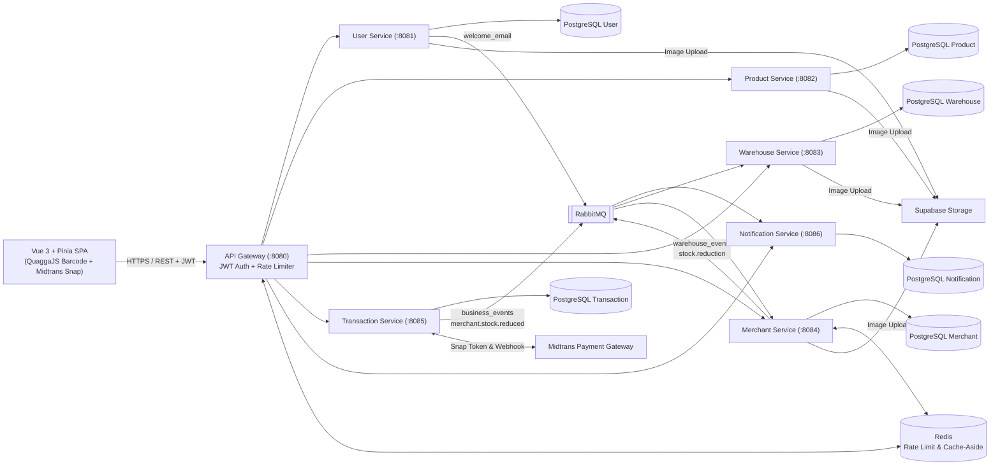

# FMCG Multi-Warehouse & Retail POS Platform

Sistem distribusi multi-gudang dan kasir (**Point of Sale**) untuk jaringan grosir & ritel FMCG / sembako kemasan, dibangun dengan **7 microservices Go (Fiber + GORM)**, **Database-per-Service (PostgreSQL)**, **Redis**, **RabbitMQ**, **Midtrans Snap**, dan **Vue.js 3 SPA**.

---

## Ringkasan Bisnis & Studi Kasus

Aplikasi ini memodelkan alur supply chain ritel modern dari **Gudang Pusat/Regional (`Warehouse`)** ke **Outlet/Toko Cabang (`Merchant`)** hingga **Transaksi Pelanggan (`POS`)**:

- **Back-Office (Manager)**: mengelola katalog master produk ber-barcode, kategori, stok di beberapa gudang, alokasi distribusi stok dari gudang ke outlet merchant, serta manajemen user & role (`Manager` / `Keeper`).
- **Front-Office / POS (Keeper)**: mengelola stok outlet yang dipegangnya, memproses checkout 3 langkah (data pelanggan → scan barcode kamera via **QuaggaJS** / pilih produk dengan validasi stok real-time → review subtotal + **PPN 11%** + pembayaran digital **Midtrans Snap**), serta memantau omzet outlet.

---

## Arsitektur Sistem



### Daftar Microservices

| Service | Port | Tanggung Jawab Utama |
|---|---|---|
| `api-gateway` | `8080` | Reverse proxy, JWT verification, header sanitization, Redis/in-memory rate limiting |
| `user-service` | `8081` | Autentikasi, manajemen user, RBAC (`Manager`, `Keeper`), auto-seeder, publish email |
| `product-service` | `8082` | Master produk, barcode lookup, kategori, upload media ke Supabase Storage |
| `warehouse-service` | `8083` | Manajemen gudang & stok gudang, consumer `stock.reduction` |
| `merchant-service` | `8084` | Manajemen outlet merchant, stok outlet, cache-aside Redis, consumer `merchant.stock.reduced` |
| `transaction-service` | `8085` | Checkout POS, server-side pricing + PPN 11%, integrasi Midtrans Snap & verifikasi webhook |
| `notification-service` | `8086` | Consumer RabbitMQ untuk pengiriman email via SMTP |

---

## Alur Event-Driven (RabbitMQ)

1. **User Onboarding**: `user-service` membuat user baru (tanpa mengirim plaintext password ke broker) → publish ke queue email → `notification-service` mengirim email selamat datang via SMTP.
2. **Distribusi Stok Gudang → Outlet**: `merchant-service` mengalokasikan stok produk dari gudang ke merchant → publish event `stock.reduction` ke exchange `warehouse_events` → `warehouse-service` mengurangi stok gudang terkait.
3. **Checkout POS → Sinkronisasi Stok Outlet**: `transaction-service` memvalidasi stok ke `merchant-service`, menghitung harga otoritatif & PPN 11% dari `product-service`, menyimpan transaksi + membuat Snap token Midtrans → publish event `merchant.stock.reduced` ke exchange `business_events` → `merchant-service` mengurangi stok outlet secara asinkron.

---

## Engineering & Security Highlights

- **Zero Trust Gateway Boundary**: `api-gateway` selalu memvalidasi signed JWT untuk semua protected route (termasuk komunikasi internal antar-service melalui token sistem) dan men-strip header internal/identitas (`X-Internal-Request`, `X-Gateway`, `X-User-*`) dari caller eksternal sebelum meneruskan request.
- **Resilient Rate Limiting**: `api-gateway` menggunakan Redis rate limiter saat Redis tersedia dan otomatis melakukan *graceful fallback* ke in-memory rate limiter jika Redis tidak aktif.
- **Authoritative Server-Side Pricing**: `transaction-service` mengambil harga produk langsung dari `product-service` dan menghitung subtotal + PPN 11% di sisi server (tidak mempercayai nominal harga dari payload client).
- **Verified Payment Webhooks**: Callback Midtrans memverifikasi `signature_key` menggunakan `SHA512(order_id + status_code + gross_amount + server_key)` dengan perbandingan *constant-time*.
- **Clean Architecture**: Setiap service memisahkan layer `controller` → `usecase` → `repository` → `model` dengan dependency injection di `app/container.go`.

---

## Struktur Repository

```text
.
├── backend/
│   ├── api-gateway/
│   ├── user-service/
│   ├── product-service/
│   ├── warehouse-service/
│   ├── merchant-service/
│   ├── transaction-service/
│   ├── notification-service/
│   ├── pkg/observability/      # Shared Prometheus metrics middleware
│   ├── observability/          # Konfigurasi Prometheus & Grafana datasource
│   ├── tests/integration/      # E2E integration test lintas service (build tag: integration)
│   └── docker-compose.yml
├── frontend/                   # Vue 3 + Vite + Pinia + Tailwind CSS + QuaggaJS
├── docs/
│   ├── README.md                   # Indeks dokumentasi arsitektur & teknis
│   ├── 01-gambaran-umum-sistem.md  # System overview, container architecture & katalog service
│   ├── 02-proses-bisnis.md         # Diagram proses bisnis, RBAC & siklus status pembayaran
│   ├── 03-proses-teknis.md         # Sequence diagram, topologi RabbitMQ & peta routing gateway
│   ├── 04-erd-dan-data-model.md    # ERD 6 database PostgreSQL & relasi logis lintas service
│   └── postman_collection.json     # Koleksi endpoint API untuk pengujian
├── .github/workflows/ci.yml    # GitHub Actions CI (Go test/vet, frontend test & Vite build)
└── Makefile                    # Shortcut setup, Docker, testing, dan build
```

---

## Cara Menjalankan Project

### Prasyarat
- Docker & Docker Compose
- Go `1.24+` (opsional, untuk menjalankan test / development lokal)
- Node.js `20+` & npm (untuk frontend)

### 1. Siapkan Environment Variables
```bash
make setup-env
```
Sesuaikan kredensial opsional di file `.env` masing-masing service jika ingin mengaktifkan fitur eksternal:
- `MIDTRANS_SERVER_KEY`, `MIDTRANS_CLIENT_KEY` di `backend/transaction-service/.env` dan `VITE_MIDTRANS_CLIENT_KEY` di `frontend/.env`
- `SUPABASE_URL`, `SUPABASE_KEY`, `SUPABASE_BUCKET` untuk upload gambar
- `EMAIL_HOST`, `EMAIL_USER`, `EMAIL_PASSWORD` di `backend/notification-service/.env`

### 2. Jalankan Backend (Docker Compose)
```bash
make build
make up
make ps
```
API Gateway akan aktif di `http://localhost:8080` (`GET /health`, `GET /metrics`), RabbitMQ Management UI di `http://localhost:15672` (`guest`/`guest`), dan **Prometheus UI** di `http://localhost:9090`.
*(Opsional)* Untuk menjalankan **Grafana** (`http://localhost:3001`, login `admin`/`admin`):
```bash
cd backend && docker compose --profile grafana up -d
```

Akun default hasil auto-seeder (`user-service`):
- **Email**: `manager@mail.com`
- **Password**: `manager123`

### 3. Jalankan Frontend (Vue 3)
```bash
cd frontend
npm install
npm run dev
```
Akses aplikasi melalui browser di `http://localhost:3000`.

---

## Pengujian & Verifikasi

Menjalankan seluruh unit test Go (`go test` di semua 7 microservice), static check (`go vet`), unit test frontend (`node --test` untuk Pinia store transaksi), dan build produksi frontend:
```bash
make test
```
Atau per bagian:
```bash
make test-backend
make vet-backend
make test-integration-gateway
make test-frontend
make build-frontend
```
### Integration Test

Integration test dipisahkan menggunakan build tag `//go:build integration` agar `make test-backend` tetap cepat tanpa dependensi eksternal:
- **Gateway Integration Test (tanpa Docker)**: menguji `/health`, JWT auth, sanitasi header internal (`X-User-*`, `X-Gateway`, `X-Internal-Request`), dan forwarding webhook Midtrans ke `httptest.Server`:
  ```bash
  make test-integration-gateway
  ```
- **E2E Multi-Service Integration Test (membutuhkan Docker stack aktif via `make up`)**: menguji alur Auth → Produk & Gudang → Distribusi ke Merchant (RabbitMQ) → Webhook Midtrans:
  ```bash
  make test-integration
  ```
  Opsional: atur `API_GATEWAY_URL` (default `http://localhost:8080`) atau `MIDTRANS_SERVER_KEY` untuk ikut memverifikasi signature callback Midtrans.
