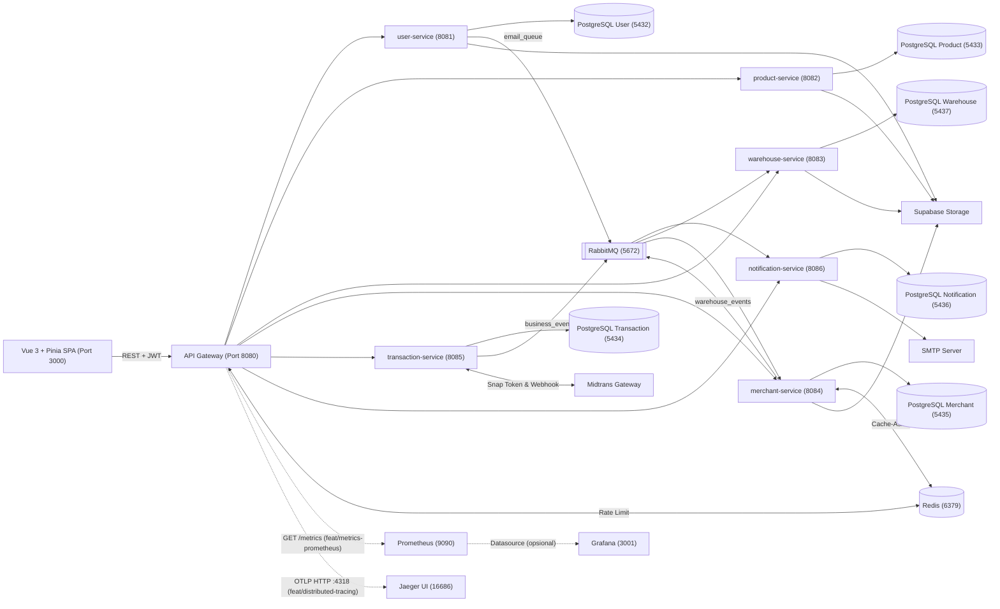

# 01. Gambaran Umum Sistem

## 1.1 Ringkasan Bisnis & Tujuan Sistem

**FMCG Multi-Warehouse & Retail POS Platform** adalah platform distribusi ritel dan kasir (*Point of Sale*) terintegrasi untuk jaringan grosir/sembako kemasan. Sistem menghubungkan operasional **Gudang Pusat/Regional (`Warehouse`)**, **Toko/Outlet Cabang (`Merchant`)**, hingga **Transaksi Pelanggan Akhir (`POS`)** dalam satu platform.

### Aktor Pengguna

| Aktor | Peran Sistem | Lingkup Operasional |
|---|---|---|
| **Manager** | `Manager` (Back-Office) | Mengelola master kategori & produk ber-barcode, gudang & stok pusat, outlet merchant, alokasi stok dari gudang ke merchant, serta manajemen user & role. |
| **Keeper** | `Keeper` (Front-Office / Kasir) | Mengelola stok pada outlet yang ditugaskan kepadanya, menjalankan kasir POS 3 langkah (pelanggan, scan barcode/keranjang, pembayaran Midtrans), dan memantau omzet outlet. |
| **Pelanggan** | Eksternal | Melakukan pembelian di outlet dan menyelesaikan pembayaran digital melalui Snap Midtrans (QRIS/VA/e-wallet). |

---

## 1.2 Arsitektur Sistem (Container View)

Sistem dibangun menggunakan pola **Microservices** dengan **7 layanan Go (Fiber + GORM)**, **Database-per-Service (PostgreSQL)**, **Redis**, **RabbitMQ**, dan **Single Page Application (Vue 3 + Pinia)**.

---

## 1.3 Katalog Microservices

| Service | Port | Database PostgreSQL | Tanggung Jawab Utama |
|---|---|---|---|
| `api-gateway` | `8080` | - | Entry point tunggal, reverse proxy, verifikasi JWT, sanitasi header internal, dan rate limiting (Redis dengan fallback in-memory). |
| `user-service` | `8081` | `warehouse_user_db` (`:5432`) | Manajemen user, role, RBAC (`Manager`, `Keeper`), auto-seeder akun awal, upload avatar, dan publish email selamat datang. |
| `product-service` | `8082` | `warehouse_product_db` (`:5433`) | Master katalog kategori & produk, lookup barcode unik, dan upload gambar produk/kategori ke Supabase Storage. |
| `warehouse-service` | `8083` | `warehouse_warehouse_db` (`:5437`) | Manajemen gudang pusat, pencatatan stok per gudang (`warehouse_products`), dan consumer event `stock.reduction`. |
| `merchant-service` | `8084` | `warehouse_merchant_db` (`:5435`) | Manajemen outlet merchant, alokasi stok dari gudang ke outlet (`merchant_products`), cache-aside Redis, dan consumer event `merchant.stock.*`. |
| `transaction-service` | `8085` | `warehouse_transaction_db` (`:5434`) | Checkout POS, kalkulasi harga otoritatif & PPN 11%, integrasi Midtrans Snap, verifikasi webhook SHA512, dashboard omzet, dan publisher `merchant.stock.reduced`. |
| `notification-service` | `8086` | `warehouse_notification_db` (`:5436`) | Consumer antrean `email_queue` dari RabbitMQ untuk mengirim email selamat datang dan email kustom via SMTP. |

---

## 1.4 Prinsip Engineering & Keamanan

1. **Zero-Trust Gateway Boundary**: `api-gateway` memvalidasi signature JWT pada seluruh rute `/api/v1/*` terproteksi, men-strip header internal (`X-Gateway`, `X-Internal-Request`, `X-User-ID`, `X-User-Email`, `X-User-Roles`) yang disisipkan pemanggil eksternal, lalu menyuntikkan ulang identitas resmi hasil dekode JWT.
2. **Database-per-Service**: Setiap microservice memiliki database PostgreSQL terisolasi sehingga tidak terjadi *cross-database table coupling*. Komunikasi data antar-service dilakukan via HTTP internal (melalui gateway dengan token sistem) atau event asinkron RabbitMQ.
3. **Authoritative Server-Side Pricing**: Nominal transaksi (`Price`, `SubTotal`, `TaxTotal` PPN 11%, `GrandTotal`) selalu dihitung ulang di `transaction-service` berdasarkan harga master dari `product-service`, bukan mempercayai harga dari payload frontend.
4. **Resilient Rate Limiting**: `api-gateway` memakai Redis rate limiter untuk skala terdistribusi dan otomatis beralih (*graceful fallback*) ke in-memory rate limiter jika Redis tidak dapat dijangkau.
5. **Clean Architecture per Service**: Struktur kode seragam di seluruh backend (`controller` → `usecase` → `repository` → `model`) dengan perakitan dependensi di `app/container.go`.
6. **Observability Terpisah per Branch Fitur**:
   - *Metrics (`feat/metrics-prometheus`)*: Seluruh 7 service Go mengekspor metrik HTTP Prometheus (`http_requests_total`, `http_request_duration_seconds`) di `GET /metrics`, di-scrape Prometheus (`:9090`), dengan opsi dashboard Grafana (`:3001` via `--profile grafana`).
   - *Distributed Tracing (`feat/distributed-tracing`)*: OpenTelemetry Go SDK mengekspor trace via OTLP HTTP ke Jaeger (`:16686`) dengan propagasi W3C `traceparent`, header respons `X-Trace-ID`, `c.UserContext()`, dan `NewTracedHTTPClient`.
7. **Verifikasi Berlapis (`make test`, Integration, & `feat/load-testing`)**: Mendukung unit test tanpa dependensi eksternal (`make test`), gateway integration test (`make test-integration-gateway`), E2E integration test (`make test-integration`), serta load testing k6 (`make load-test` pada branch `feat/load-testing`). Detail lengkap tersedia di [05 - Observability & Pengujian](05-observability-dan-pengujian.md).
