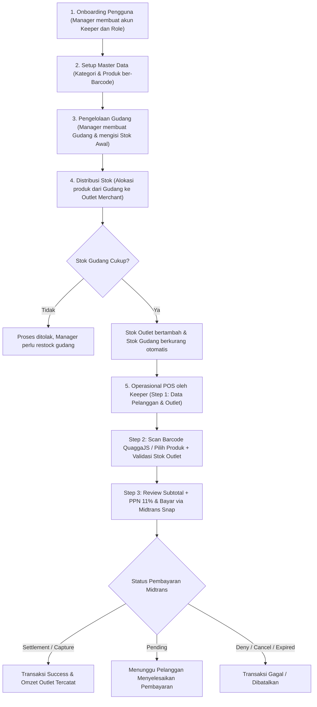
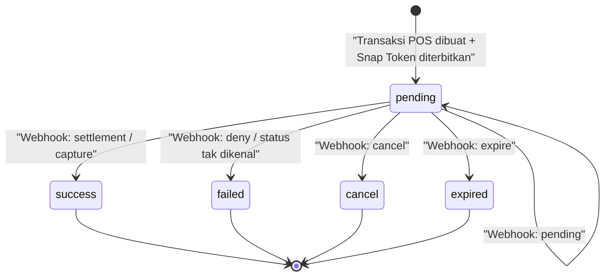

# 02. Diagram Proses Bisnis

Dokumen ini menjelaskan alur operasional bisnis dari hulu (gudang pusat) hingga hilir (kasir outlet dan pembayaran pelanggan).

---

## 2.1 Alur Bisnis Supply Chain & Retail POS (End-to-End)

---

## 2.2 Matriks Hak Akses & Kapabilitas (RBAC)

| Modul / Fitur | Manager (Back-Office) | Keeper (Front-Office / POS) |
|---|---|---|
| **Login & Profil Pribadi** | Ya | Ya |
| **Dashboard Global** | Omzet, total transaksi, produk terjual seluruh jaringan | Tidak (diarahkan ke dashboard outlet) |
| **Dashboard Outlet (`My Merchants`)** | Lihat daftar merchant | Lihat outlet milik sendiri & statistik omzet outlet |
| **Manajemen User & Role** | CRUD User, Role, dan Assign Role | Tidak |
| **Manajemen Kategori & Produk** | CRUD Kategori, Produk, Barcode, Upload Foto | Hanya membaca katalog produk outlet |
| **Manajemen Gudang & Stok Gudang** | CRUD Gudang dan tambah/ubah stok gudang | Tidak |
| **Distribusi Stok Gudang ke Merchant** | Alokasi dan penyesuaian stok merchant | Lihat stok outlet yang dipegang |
| **Transaksi Kasir (POS)** | Melihat seluruh riwayat transaksi | Membuat transaksi baru (3 langkah) & melihat transaksi outlet |

---

## 2.3 Aturan Bisnis Utama

1. **Pajak Pertambahan Nilai (PPN 11%)**:
   Setiap transaksi POS otomatis dikenakan pajak sebesar `11%` (`ppnRate = 0.11`) dari `SubTotal` yang dibulatkan ke bilangan bulat terdekat (`GrandTotal = SubTotal + TaxTotal`).
2. **Validasi Stok Berlapis**:
   * **Saat distribusi ke outlet**: jumlah stok yang dialokasikan tidak boleh melebihi stok tersedia pada gudang asal (`warehouse_products.stock`).
   * **Saat checkout POS**: kuantitas item keranjang divalidasi langsung terhadap stok outlet (`merchant_products.stock`) sebelum transaksi disimpan.
3. **Pemetaan Status Pembayaran Midtrans**:

