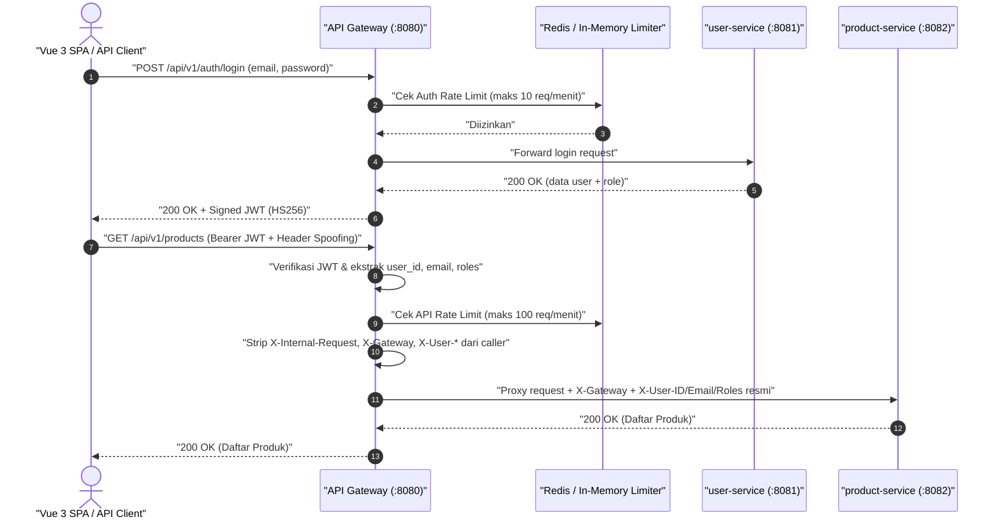
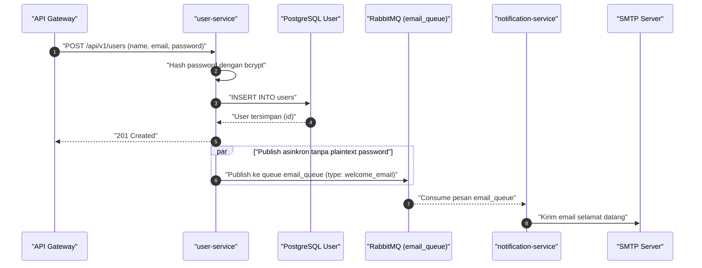
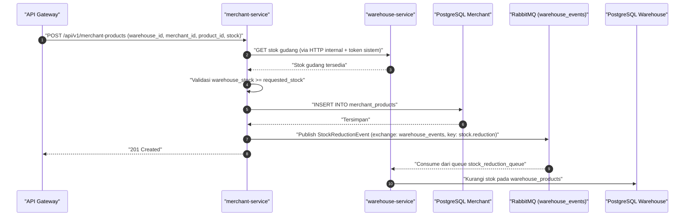
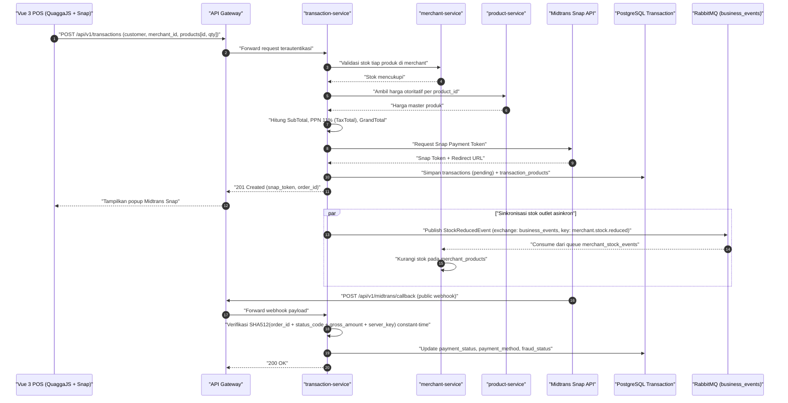
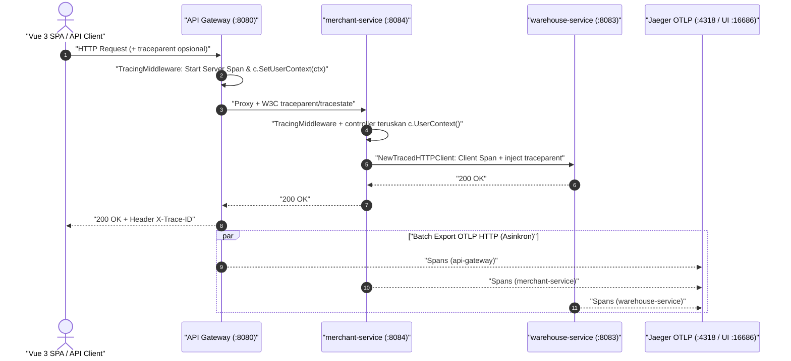
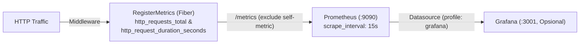

# 03. Diagram Proses Teknis

Dokumen ini memetakan interaksi teknis antar-komponen (HTTP sinkron, Redis, RabbitMQ asinkron, dan integrasi pihak ketiga).

---

## 3.1 Autentikasi, Sanitasi Header & Proteksi Gateway

---

## 3.2 User Onboarding Asinkron (RabbitMQ)

---

## 3.3 Distribusi Stok Gudang ke Outlet Merchant

---

## 3.4 Checkout POS, Server-Side Pricing & Webhook Midtrans

---

## 3.5 Topologi Messaging RabbitMQ

| Exchange | Tipe | Routing Key | Queue | Producer | Consumer | Tujuan |
|---|---|---|---|---|---|---|
| *(default)* | direct | `email_queue` | `email_queue` | `user-service` | `notification-service` | Pengiriman email selamat datang (tanpa plaintext password) |
| `warehouse_events` | topic | `stock.reduction` | `stock_reduction_queue` | `merchant-service` | `warehouse-service` | Mengurangi stok gudang saat stok dialokasikan ke merchant |
| `business_events` | topic | `merchant.stock.reduced` (binding `merchant.stock.*`) | `merchant_stock_events` | `transaction-service` | `merchant-service` | Mengurangi stok outlet merchant saat transaksi POS dibuat |

---

## 3.6 Peta Routing API Gateway (`:8080`)

| Prefix Path | Autentikasi | Rate Limit | Service Tujuan |
|---|---|---|---|
| `GET /health` | Publik | Global | Internal API Gateway |
| `GET /metrics` *(branch `feat/metrics-prometheus`)* | Publik | Global | Prometheus Metrics (API Gateway & tiap service) |
| `POST /api/v1/auth/login` | Publik | Auth (`10 req/min`) | `user-service` (`:8081`) |
| `POST /api/v1/midtrans/callback` | Publik (verifikasi SHA512 di service) | Global | `transaction-service` (`:8085`) |
| `/api/v1/users*`, `/api/v1/roles*`, `/api/v1/assign-role*`, `/api/v1/upload*` | JWT Protected | API (`100 req/min`) | `user-service` (`:8081`) |
| `/api/v1/products*`, `/api/v1/categories*`, `/api/v1/upload-product*` | JWT Protected | API (`100 req/min`) | `product-service` (`:8082`) |
| `/api/v1/warehouses*`, `/api/v1/warehouse-products*`, `/api/v1/upload-warehouse*` | JWT Protected | API (`100 req/min`) | `warehouse-service` (`:8083`) |
| `/api/v1/merchants*`, `/api/v1/merchant-products*`, `/api/v1/upload-merchant*` | JWT Protected | API (`100 req/min`) | `merchant-service` (`:8084`) |
| `/api/v1/transactions*`, `/api/v1/dashboard*` | JWT Protected | API (`100 req/min`) | `transaction-service` (`:8085`) |

---

## 3.7 Alur Distributed Tracing Lintas Service *(branch `feat/distributed-tracing`)*

---

## 3.8 Alur Scraping Metrics Prometheus *(branch `feat/metrics-prometheus`)*

