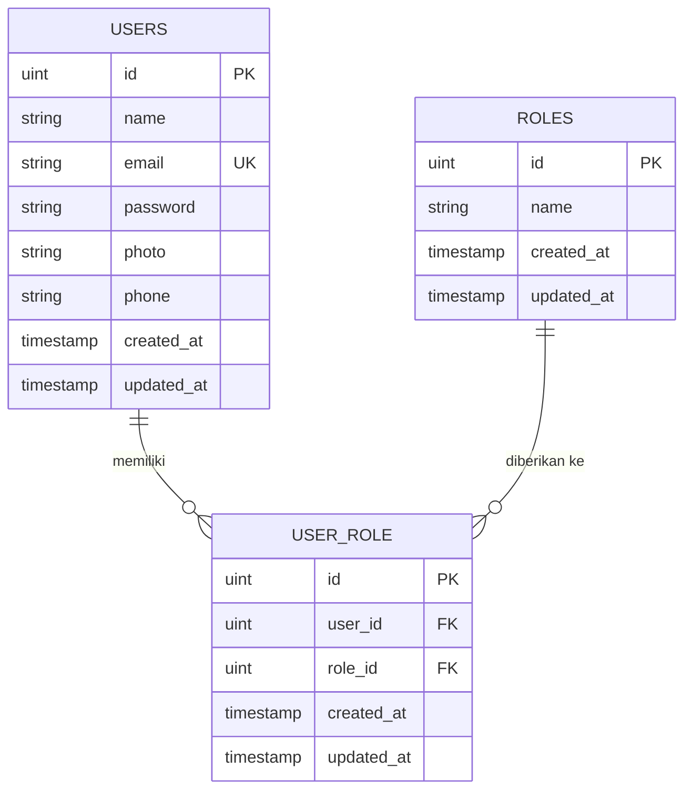
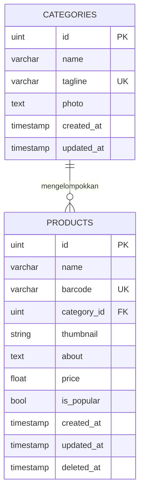
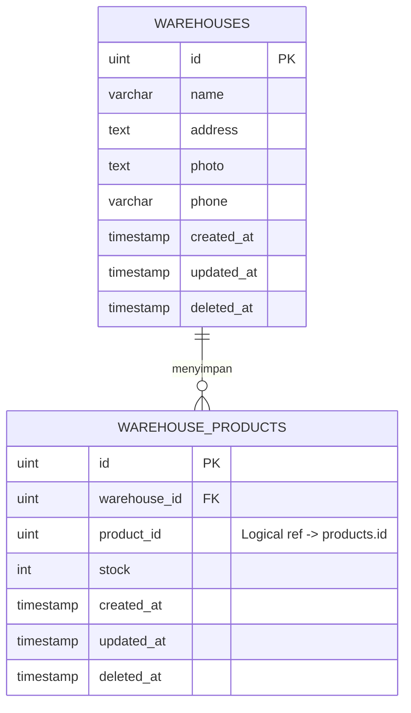
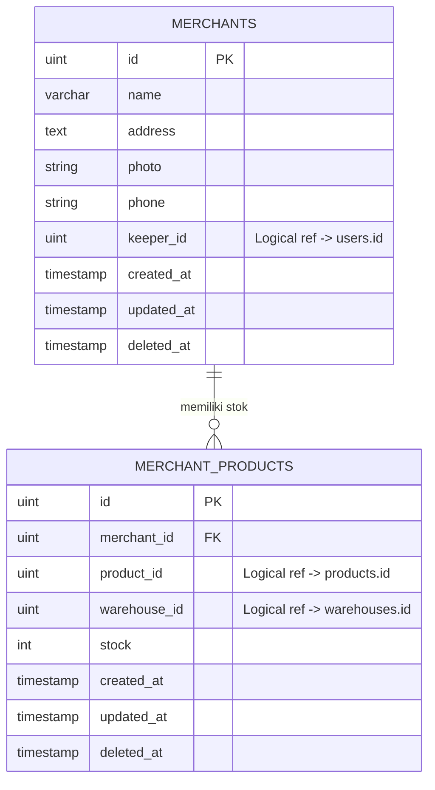
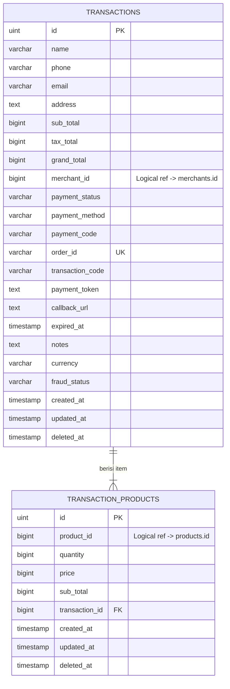

# 04. ERD & Model Data

Sistem menerapkan pola **Database-per-Service** dengan **6 instance PostgreSQL terpisah**. Foreign key relasional SQL hanya berlaku di dalam database masing-masing service, sedangkan keterkaitan antar-service dihubungkan melalui **ID referensi logis** (`product_id`, `warehouse_id`, `merchant_id`, `keeper_id`) yang divalidasi via API internal maupun event RabbitMQ.

---

## 4.1 Diagram ERD per Bounded Context

### A. User Service (`warehouse_user_db` — Port `5432`)

### B. Product Service (`warehouse_product_db` — Port `5433`)

### C. Warehouse Service (`warehouse_warehouse_db` — Port `5437`)

### D. Merchant Service (`warehouse_merchant_db` — Port `5435`)

### E. Transaction Service (`warehouse_transaction_db` — Port `5434`)

> **Catatan `notification-service` (`warehouse_notification_db` — Port `5436`)**: Database disiapkan pada infrastruktur Docker untuk isolasi service, sementara pemrosesan email saat ini berjalan secara *stateless* langsung dari antrean RabbitMQ (`email_queue`) ke SMTP.

---

## 4.2 Peta Relasi Logis Lintas Database

| Sumber Tabel & Kolom | Target Service & Tabel | Mekanisme Validasi / Sinkronisasi |
|---|---|---|
| `warehouse_products.product_id` | `product-service` → `products.id` | HTTP lookup saat pengayaan detail gudang & produk |
| `merchants.keeper_id` | `user-service` → `users.id` | Validasi kepemilikan outlet untuk role `Keeper` |
| `merchant_products.product_id` | `product-service` → `products.id` | HTTP lookup katalog & barcode produk |
| `merchant_products.warehouse_id` | `warehouse-service` → `warehouses.id` | Cek stok gudang asal via HTTP + kurangi stok via RabbitMQ `stock.reduction` |
| `transactions.merchant_id` | `merchant-service` → `merchants.id` | Validasi outlet & pengurangan stok outlet via RabbitMQ `merchant.stock.reduced` |
| `transaction_products.product_id` | `product-service` → `products.id` | Ambil harga otoritatif server-side + validasi stok ke `merchant-service` |

---

## 4.3 Indeks, Constraint & Soft Delete

* **Unique Index / Constraint**:
  * `users.email` (mencegah duplikasi akun pengguna)
  * `categories.tagline` (mencegah tagline kategori ganda)
  * `products.barcode` (menjamin 1 barcode hanya menunjuk 1 master produk untuk scan kamera POS)
  * `transactions.order_id` (idempotensi dan lookup webhook Midtrans)
* **Soft Delete (`deleted_at`)**:
  Diterapkan pada `products`, `warehouses`, `warehouse_products`, `merchants`, `merchant_products`, `transactions`, dan `transaction_products` agar histori transaksi serta audit stok tetap terjaga.
